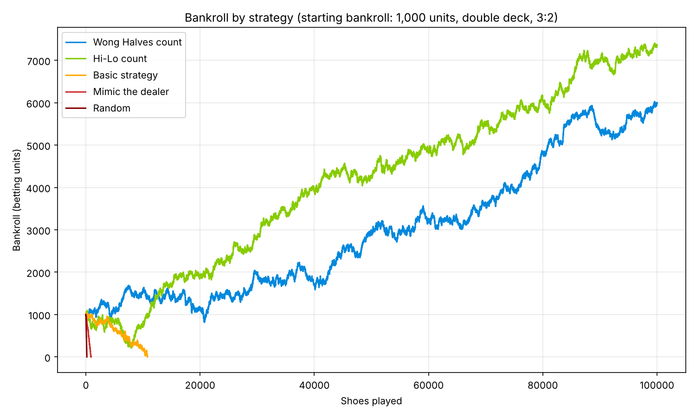

# Blackjack Strategy Simulator

A blackjack engine in Python that pits playing strategies against each other over hundreds of thousands of simulated shoes, from a bot that plays randomly up to card-counting bots and a **"PerfectBot" that computes the exact expected value of every possible action** from the cards left in the shoe.



## Results

100,000 shoes per bot, starting with 1,000 betting units. Double deck, dealer hits soft 17, blackjack pays 3:2, double after split and re-split aces allowed, no surrender, 70–75% penetration.

| Strategy | Player edge | Outcome |
|---|---|---|
| Hi-Lo card counting | **+0.33%** | Grew bankroll to ~7,400 units |
| Wong Halves card counting | **+0.26%** | Grew bankroll to ~6,000 units |
| Basic strategy (no counting) | −0.58% | Ruined after ~10,800 shoes |
| Mimic the dealer | −7.9% | Ruined after ~900 shoes |
| Random decisions | −30% | Ruined after ~170 shoes |

*Player edge = (total returned − total wagered) / total wagered. Reproduce with `python compare_bots.py --seed 42`. Results vary run to run: the two counting systems are close, and either can come out ahead.*

The takeaway matches blackjack theory: perfect basic strategy still loses slowly to the house, and a modest card count that plays more hands when the deck is rich in tens and aces is enough to flip the game to a small, consistent player edge.

## The bots

| Bot | How it decides |
|---|---|
| `Bot` | Picks a random legal action. |
| `H17DealerBot` | Plays like the dealer: hits below 17 and on soft 17. |
| `BasicStrategyH17Bot` | Standard basic-strategy charts (hard, soft, split, surrender) for H17 games, with optional double-after-split rules. |
| `SimpleHiLoCountingNoDev` | Basic strategy plus the Hi-Lo count. Plays extra hands (up to `maxHands`) when the true count is +1 or higher, and takes insurance when the count favors it. |
| `WongHalvesBot` | Same idea with the more precise Wong Halves count (fractional card values). |
| `PerfectBot` | No charts at all. For each decision it computes the exact EV of hit, stand, double, split and surrender given the precise composition of the remaining shoe, and picks the best one. |

### How PerfectBot works

- **`pWin`** recursively plays out every possible dealer draw sequence, weighted by the probability of each card given the remaining shoe, to get the EV of standing on a total.
- **`calcHitEv`** recursively considers every card the player could draw next, and at each step takes the better of standing or hitting again.
- **`calcDoubleEv`** and **`splitEv`** build on those for doubling (one card, double bet) and splitting (two hands, each played optimally).
- Results are **memoized** on (hand total, softness, dealer hand, remaining card counts), and recursion is depth-limited, which keeps an otherwise exponential search tractable for single decisions.

Simulating PerfectBot over thousands of shoes is still very compute- and memory-heavy, since the cache grows with every unique shoe composition, so it's best used interactively (see `play.py`) or for short runs.

## Project structure

```
blackjack/
  card.py      Card with blackjack value (aces count as 1; Hand handles 11)
  shoe.py      Multi-deck shoe with a randomly placed cut card
  hand.py      Hand totals, soft/hard detection, split/double state
  bots.py      All strategy bots, including PerfectBot
  game.py      Game rules (H17, 3:2 vs 6:5, DAS, RSA, surrender),
               interactive play() and bot simulation simPlay()
compare_bots.py   Runs every bot on the same game and plots bankrolls
play.py           Play in the terminal with PerfectBot suggesting moves
results/          Generated chart and run log
```

## Run it

```bash
pip install -r requirements.txt

# Compare strategies (about 3 minutes at 100,000 shoes; use --shoes 10000 for a quick run)
python compare_bots.py --shoes 100000 --seed 42

# Play yourself, with PerfectBot's suggested move shown at every decision
python play.py
```

Game rules are configurable through `Game(h17=..., blackjack=..., rsa=..., das=..., surrender=...)`. For example, `blackjack=1.2` simulates a 6:5 table, which makes even the counting bots lose.

## Built with

Python 3.10+ and Matplotlib.

---
Luke Sundquist · [LinkedIn](https://www.linkedin.com/in/luke-sundquist/)
